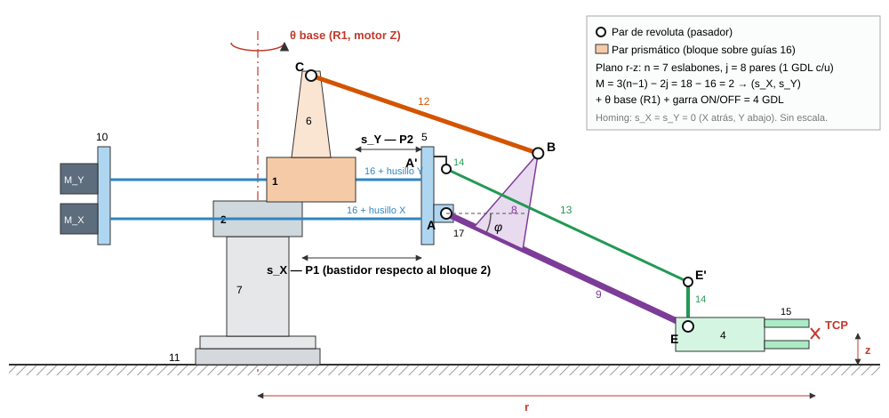
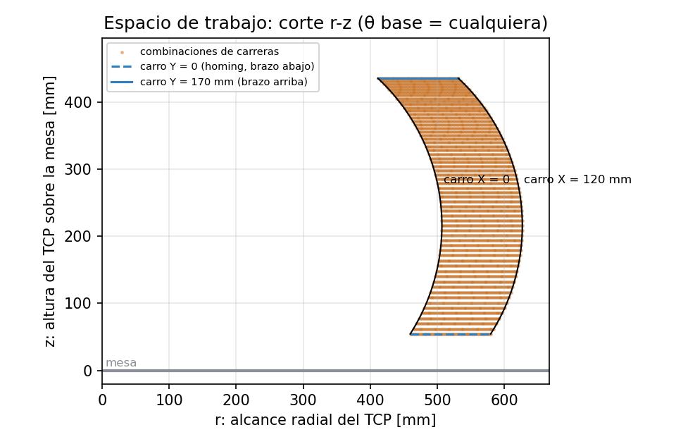
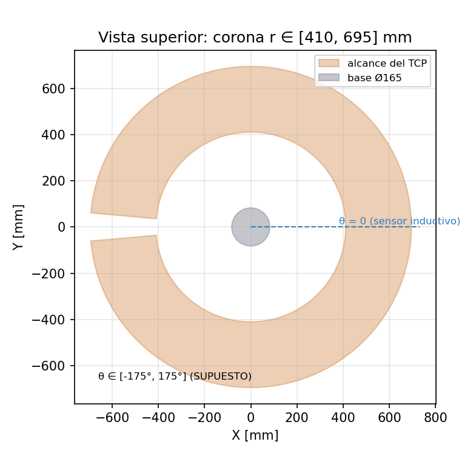

# Cinemática y modelo 3D del brazo XK-JS1-1

Resumen del gemelo digital geométrico (II-2026). El desarrollo completo está en
[`informe/informe_cinematica_modelo_3d.tex`](informe/informe_cinematica_modelo_3d.tex) y el levantamiento de
medidas en [`levantamiento/levantamiento_medidas.md`](levantamiento/levantamiento_medidas.md).

> **Modelo aproximado.** Las cotas marcadas **SUPUESTO** o estimadas de foto (posición de los pivotes A y C,
> balancín $a$ y $\beta$, brazo $L_9$, pinza, recorridos, paso del husillo, micropasos y reducción de la base)
> deben medirse en la planta. Las estimadas se ajustaron con la foto de perfil del manual: el modelo reproduce
> esa pose con menos de 5 mm de diferencia en los pivotes B y C. Están todas en un solo lugar: `web/js/cinematica.js`.

## 1. Variables

| Símbolo | Significado | Rango |
|---|---|---|
| $\theta$ | giro de la base (motor Z, NEMA 17) | −175° a 175° (SUPUESTO) |
| $s_X$ | carrera del carro X desde su final trasero (homing): el bastidor completo se desliza por el bloque 2 | 0 a 120 mm (SUPUESTO, ficha del fabricante) |
| $s_Y$ | carrera del carro Y desde su final inferior (homing): al crecer, el bloque 1 retrocede sobre el bastidor y el brazo sube | 0 a 170 mm (SUPUESTO) |
| $\varphi$ | ángulo del brazo 9 respecto a la horizontal (pasivo) | −32.6° (homing) a 47.0° |
| $(X, Y, Z)$ | posición de la garra (TCP); origen en el eje de giro sobre la mesa | — |

Grados de libertad en el plano del brazo (Grübler-Kutzbach, $n = 7$ eslabones, $j = 8$ pares de 1 GDL):

$$ M = 3(n-1) - 2j = 3\cdot 6 - 2\cdot 8 = 2 $$

Con el giro de la base y la garra ON/OFF quedan los **4 GDL** del equipo.

## 2. Cinemática directa

**Lazo de la biela 12.** Con $A$ como origen en el bastidor, el pivote $C$ de la escuadra 6 está en

$$ \mathbf{C} - \mathbf{A} = \begin{bmatrix} g + c_{u0} \\ c_h \end{bmatrix},\qquad g = S_Y - s_Y,\qquad c_{u0} = -252\ \text{mm},\quad c_h = 125\ \text{mm} $$

donde $g$ es cuánto se alejó el bloque 1 de su tope trasero y $S_Y = 170$ mm es la carrera total del carro Y.

y el vértice $B$ del balancín en $\mathbf{B} - \mathbf{A} = a\,[\cos\psi,\ \sin\psi]^T$. Cerrar el lazo
$|\mathbf{B} - \mathbf{C}| = L_{12}$ da (ley de cosenos):

$$ d = \sqrt{(g + c_{u0})^2 + c_h^2},\qquad \psi = \operatorname{atan2}(c_h,\ g + c_{u0}) - \arccos\!\left(\frac{a^2 + d^2 - L_{12}^2}{2\,a\,d}\right) $$

El signo menos elige la rama de montaje real. El brazo forma un ángulo fijo $\beta$ con $A$-$B$:

$$ \varphi = \psi - \beta $$

**Posición de la garra.** El paralelogramo (varilla 13 y postes 14) mantiene la pinza horizontal, así que

$$ r = u_{50} + s_X + u_A + L_9\cos\varphi + d_g, \qquad z = h_A + L_9\sin\varphi - h_g $$

$$ X = r\cos\theta,\qquad Y = r\sin\theta,\qquad Z = z $$

El carro X solo traslada el brazo en dirección radial. El carro Y cambia $\varphi$, y con ello mueve la garra
sobre un arco que cambia a la vez $r$ y $z$.

| Parámetro | Valor | Origen |
|---|---|---|
| $a$, $\beta$ | 145 mm, 50° | estimado de la foto del manual |
| $L_{12}$ | 235 mm | boceto de la pieza 12 (24 cm de largo total) |
| $L_9$ | 300 mm | igual a la varilla 13 (paralelogramo) |
| $u_{50} + u_A$ | 52 + 20 mm | estimado de la foto |
| $h_A$ | 236 mm (altura del husillo superior) | estimado de la foto |
| $d_g$, $h_g$ | 135 mm, 20 mm | estimado de la foto |

## 3. Cinemática inversa

Dado $(X, Y, Z)$:

$$ \theta = \operatorname{atan2}(Y, X)\ \ (\text{o } \theta \pm 360^\circ,\ \text{la más cercana a la actual dentro del rango}),\qquad r = \sqrt{X^2+Y^2} $$

$$ \sin\varphi = \frac{Z + h_g - h_A}{L_9} \;\Rightarrow\; \varphi_1 = \arcsin(\cdot),\quad \varphi_2 = \pi - \varphi_1 $$

$$ s_X = r - d_g - L_9\cos\varphi - u_{50} - u_A $$

$$ g = a\cos(\varphi+\beta) \pm \sqrt{L_{12}^2 - \big(c_h - a\sin(\varphi+\beta)\big)^2} - c_{u0},\qquad s_Y = S_Y - g $$

Se generan las combinaciones de $\theta$, $\varphi_{1,2}$ y $\pm$. Solo se acepta la que reproduce la rama de
montaje de la directa ($\varphi_2$, con el brazo hacia atrás, nunca la cumple). Además deben respetarse los
recorridos de los carros y no debe haber colisión con la mesa. Si $|\sin\varphi| > 1$, si el radicando es
negativo o si ninguna solución cumple los límites, la posición es **inalcanzable**.

## 4. Jacobiano y singularidades

Derivando el cierre del lazo $f = |a\,\mathbf{e}(\psi) - (\mathbf{C} - \mathbf{A})|^2 - L_{12}^2 = 0$ respecto de $g$:

$$ \frac{d\varphi}{ds_Y} = -\frac{d\psi}{dg} = -\frac{(B-C)_u}{a\,(\mathbf{B}-\mathbf{C})\cdot\mathbf{e}_\perp(\psi)} $$

$$ J = \frac{\partial(X,Y,Z)}{\partial(\theta, s_X, s_Y)} = \begin{bmatrix} -r\sin\theta & \cos\theta & -\cos\theta\,L_9\sin\varphi\,\varphi' \\ r\cos\theta & \sin\theta & -\sin\theta\,L_9\sin\varphi\,\varphi' \\ 0 & 0 & L_9\cos\varphi\,\varphi' \end{bmatrix},\qquad \det J = r\,L_9\cos\varphi\,\varphi' $$

Hay singularidad si $r = 0$, si $\cos\varphi = 0$ (brazo vertical), si $\varphi' = 0$ (biela 12 vertical) o si
$\varphi' \to \infty$ (punto muerto: biela 12 alineada con $A$-$B$). **Con los parámetros actuales ninguna ocurre
dentro del recorrido.** El ángulo de transmisión de la biela varía entre 38° y 92°.

## 5. Relación motor → articulación

$$ \Delta s = \frac{p}{N_{\text{paso}}\,\mu}\,N_p,\qquad \Delta\theta = \frac{360^\circ}{N_{\text{paso}}\,\mu_Z\,i_\theta}\,N_p $$

| Eje | Supuesto | Resolución |
|---|---|---|
| Carros X, Y | $p = 5$ mm/rev, $N_{\text{paso}} = 200$, $\mu = 8$ (DIP SW4-SW7 = 0 0 1 1, 1600 pulsos/rev) | **0.003125 mm/pulso** (320 pulsos/mm) |
| Base | $\mu_Z = 8$, reducción $i_\theta = 5$ | **0.045 °/pulso** (22.2 pulsos/°) |

A 20 kHz (máximo del PTO) esto da 62.5 mm/s en los carros y 900 °/s en la base. La posición se estima contando
pulsos desde el homing, $q_{\text{est}} = q_0 + N_p\,\Delta q$. El homing lleva el carro X a su final trasero (I0.1) y
el carro Y a su final inferior (I0.4): ahí $s_X = s_Y = 0$ y los contadores parten de cero.

**Observación sobre las salidas.** La CPU 224 solo tiene PTO en Q0.0 y Q0.1. Según el manual (tabla 2-1) y el
Informe Lab 2, Q0.0 da los pulsos de la base, Q0.1 es un **PTO compartido** para X e Y, y Q0.5/Q0.6 (relés
K1/K2) eligen qué driver recibe esos pulsos. Por eso **X e Y no pueden moverse a la vez**: en el PLC real la
trayectoria cartesiana recta no es posible, solo movimientos por turnos. La página permite simular ambos casos.

## 6. Espacio de trabajo

Alcance $r$ de 411 a 627 mm y altura $z$ de 54 a 436 mm. Son unos 382 mm de recorrido vertical: la ficha
comercial del fabricante indica 0-400 mm en vertical y 0-120 mm adelante-atrás, y el manual 440 mm para el eje Y. En planta el alcance es una corona de ±175°.

## 7. Modelo 3D y validación

- `global/modelo-3d/brazo_xk-js1-1.glb` (260 KB) se genera con `node global/modelo-3d/generar_modelo.js` a partir
  de los mismos parámetros. Cada pieza móvil es un nodo con el origen en su pivote o su guía.
- Las pruebas (`node semestres/2026_II/modelo-3d/cinematica/pruebas_cinematica.js`) dan:
  - directa → inversa → directa: error < 1e-12 mm;
  - jacobiano analítico frente al numérico: error < 1e-7;
  - Python frente a JavaScript: diferencia < 0.05 mm (redondeo de la tabla).
- En la página, la tarjeta "Modelo vs FK" compara en vivo el TCP del modelo 3D con la cinemática directa.
- Falta la validación contra la planta: medir $(r, z)$ de la garra en las 25 posiciones de
  `cinematica/tabla_cinematica.csv`.
